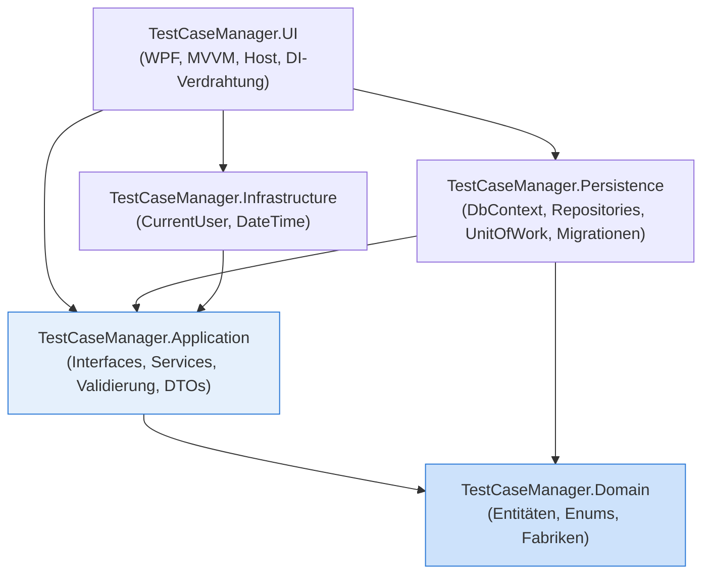
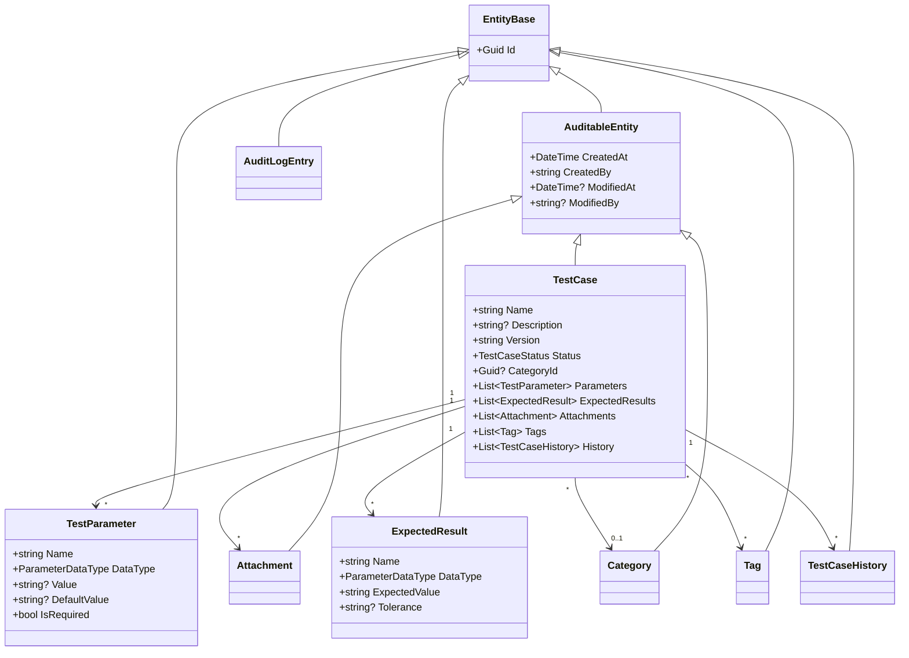
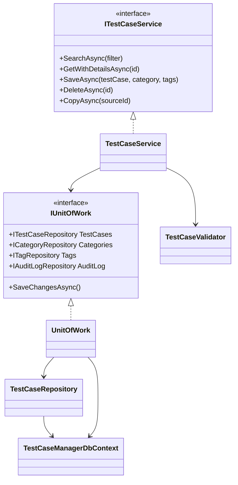
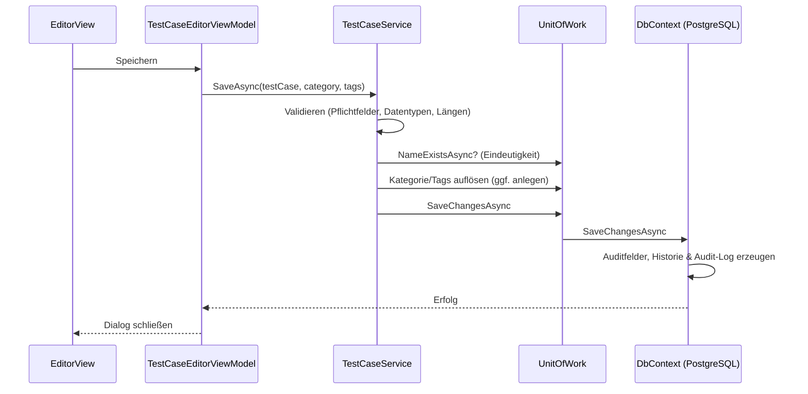

# Architekturübersicht

Die Anwendung folgt der **Clean Architecture** (Schichtenarchitektur mit
Abhängigkeiten ausschließlich nach innen). Der fachliche Kern kennt weder
Datenbank noch Oberfläche; technische Details liegen in den äußeren Schichten und
werden über Interfaces entkoppelt.

## Schichten und Abhängigkeitsrichtung

- **Domain** – reiner Fachkern ohne externe Abhängigkeiten: Entitäten, Enums,
  die `TestCaseFactory` und deutsche Anzeigenamen (`EnumDisplayExtensions`).
- **Application** – definiert die **Verträge** (Repository-, Unit-of-Work-,
  Service-Interfaces), die **Anwendungsfälle** (`TestCaseService` usw.), die
  **Validierung** und die **DTOs** für die Anzeige. Kennt nur die Domäne.
- **Persistence** – implementiert die Verträge mit Entity Framework Core und
  PostgreSQL: `DbContext`, Repositories, `UnitOfWork`, `DatabaseInitializer`,
  Migrationen. Erzeugt Auditfelder, Historie und Audit-Log **automatisch** beim
  Speichern.
- **Infrastructure** – Querschnittsdienste (aktueller Windows-Benutzer, Systemzeit).
- **UI** – WPF-Oberfläche nach dem **MVVM**-Muster, Host-Aufbau, Dependency
  Injection, Konfiguration und Logging.

Weil die inneren Schichten die äußeren nicht kennen, lassen sich Datenbank oder
Oberfläche austauschen, ohne die Geschäftslogik zu berühren.

## Eingesetzte Design Patterns

| Pattern | Umsetzung | Zweck |
|---------|-----------|-------|
| **Repository** | `IRepository<T>`, `ITestCaseRepository`, … in *Application*; Implementierungen in *Persistence* | Kapselt den Datenzugriff hinter fachlichen Schnittstellen |
| **Unit of Work** | `IUnitOfWork` / `UnitOfWork` | Bündelt Repositories und speichert atomar in einer Transaktion |
| **Service Layer** | `TestCaseService`, `DashboardService`, … | Bündelt die Anwendungsfälle / Geschäftslogik |
| **Factory** | `TestCaseFactory` | Erzeugt neue Testfälle und tiefe Kopien mit sinnvollen Standardwerten |
| **Dependency Injection** | `Microsoft.Extensions.DependencyInjection`, `AddApplication/AddPersistence/AddInfrastructure` | Lose Kopplung, Testbarkeit |
| **MVVM** | Views + ViewModels (CommunityToolkit.Mvvm) | Trennt Darstellung von Logik |
| **Options/Configuration** | `appsettings.json` + Host | Zentralisierte Einstellungen |

## Lebensdauern (Dependency Injection)

- **Scoped** (`DbContext`, `UnitOfWork`, alle Services): Pro Vorgang/Dialog wird
  über die `IServiceScopeFactory` ein eigener Bereich geöffnet. Alle in diesem
  Bereich geladenen Entitäten werden von **derselben** Arbeitseinheit nachverfolgt
  und beim Speichern gemeinsam persistiert. Das entspricht dem Muster
  „Unit of Work pro Bildschirm/Dialog“ und vermeidet langlebige DbContexts.
- **Singleton** (`ICurrentUserService`, `IDateTimeProvider`, `TestCaseValidator`,
  Haupt-ViewModels, `IDialogService`): zustandsarme bzw. anwendungsweite Dienste.

## Automatische Protokollierung im DbContext

Der `TestCaseManagerDbContext` überschreibt `SaveChangesAsync` und erledigt dort
drei Querschnittsaufgaben, sodass keine Codestelle sie „vergessen“ kann:

1. **Auditfelder** (`CreatedAt/By`, `ModifiedAt/By`) füllen.
2. **Änderungshistorie** (`TestCaseHistory`) je geänderter Eigenschaft mit altem
   und neuem Wert schreiben – auch für Parameter, Ergebnisse, Anhänge und Tags.
3. **Audit-Log** (`AuditLogEntry`) je betroffenem Datensatz schreiben.

## Klassendiagramm (Kernklassen)

## Ablauf: Testfall speichern

