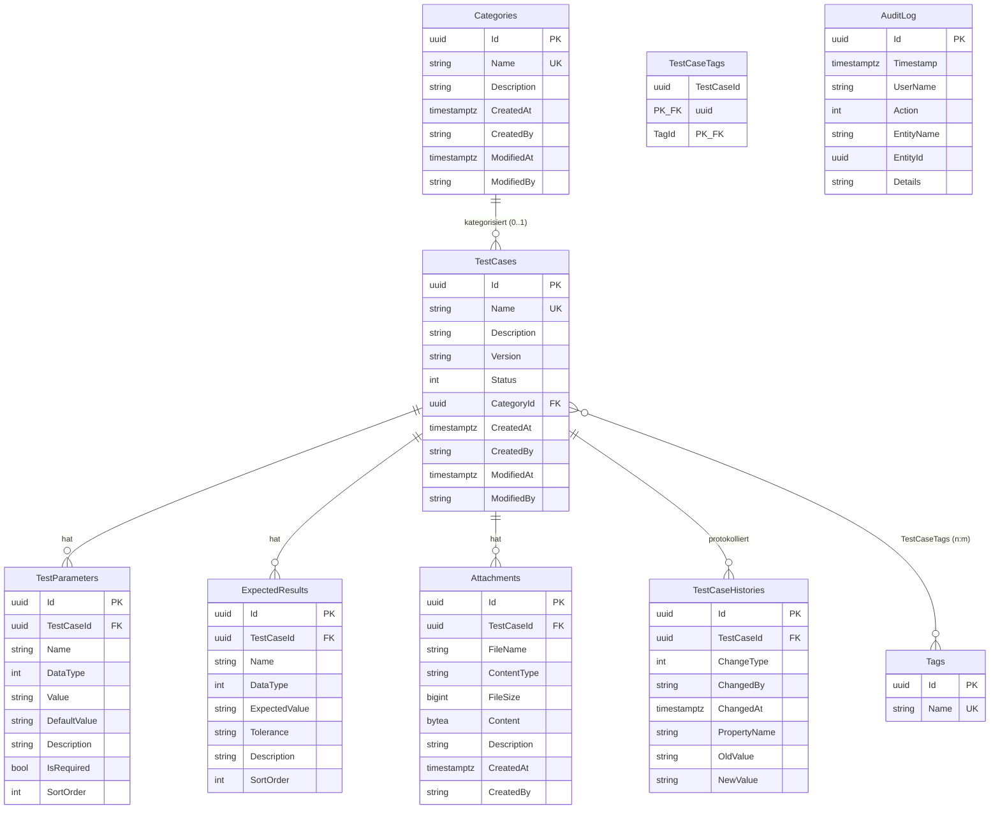

# Datenmodell

Das relationale Datenmodell bildet Testfälle mit beliebig vielen Parametern,
erwarteten Ergebnissen, Anhängen und Tags sowie eine lückenlose Historie ab.
Alle Primärschlüssel sind `uuid` (GUID) und werden bereits clientseitig erzeugt.

## ER-Diagramm

> Das `AuditLog` steht bewusst ohne Fremdschlüssel für sich: Es protokolliert
> Aktionen über **alle** Entitätstypen hinweg (auch nach deren Löschung).

## Tabellen im Detail

### TestCases
Zentrale Tabelle. Ein Testfall besitzt Stammdaten (Name, Beschreibung, Version,
Status) und eine optionale Kategorie.

| Spalte | Typ | Bemerkung |
|--------|-----|-----------|
| Id | uuid | Primärschlüssel |
| Name | varchar(200) | **eindeutig** (Index `IX_TestCases_Name`) |
| Description | varchar(2000) | optional |
| Version | varchar(50) | Pflicht |
| Status | int | Enum `TestCaseStatus` (0=Entwurf … 4=Veraltet) |
| CategoryId | uuid | FK → Categories, `ON DELETE SET NULL` |
| CreatedAt/By, ModifiedAt/By | | Auditfelder, automatisch |

Indizes: `Name` (unique), `Status`, `CategoryId`, `ModifiedAt`.

### TestParameters
Beliebig viele Eingabeparameter pro Testfall. Der Wert wird **typneutral** als
Text gespeichert; `DataType` steuert Validierung und Interpretation.

- Eindeutigkeit: `(TestCaseId, Name)` – ein Parametername je Testfall nur einmal.
- `ON DELETE CASCADE` mit dem Testfall.

### ExpectedResults
Beliebig viele erwartete Ergebnisse pro Testfall, optional mit `Tolerance` für
numerische Vergleiche. `ON DELETE CASCADE`.

### Attachments
Dateianhänge (Dokumente, Bilder, PDFs). Der Inhalt liegt als `bytea` direkt in
der Datenbank (`Content`), sodass keine externen Dateipfade gepflegt werden
müssen. `ON DELETE CASCADE`.

### Categories / Tags
Stammdaten zur Gruppierung. Namen sind jeweils **systemweit eindeutig**. Tags
stehen über die Verknüpfungstabelle **TestCaseTags** in einer n:m-Beziehung zu
Testfällen.

### TestCaseHistories
Feldgenaue Änderungshistorie eines Testfalls: je geänderter Eigenschaft ein
Eintrag mit `OldValue`/`NewValue`, `ChangedBy` und `ChangedAt`. Auch Änderungen
an Parametern, Ergebnissen, Anhängen und Tag-Zuordnungen werden hier vermerkt.
Index: `(TestCaseId, ChangedAt)`.

### AuditLog
Übergreifendes Protokoll auf Datensatzebene (Anlegen/Ändern/Löschen) für alle
Entitätstypen. Index: `Timestamp`.

## Wertespeicherung von Parametern (Erweiterbarkeit)

Da Werte als Text gespeichert und über `DataType` interpretiert werden, sind
**beliebig viele Parameter unterschiedlichster Typen** möglich, ohne das Schema
zu ändern. Neue Datentypen werden allein durch Erweiterung des Enums
`ParameterDataType` und der Prüfung in `ParameterValueParser` ergänzt – kein
Datenbank-Refactoring nötig.

## Unterstützte Datentypen (`ParameterDataType`)

| Wert | Bedeutung | Validierung |
|------|-----------|-------------|
| Text | Freitext | keine |
| Integer | Ganzzahl | `long` (invariant) |
| Decimal | Dezimalzahl | deutsch (Komma) **oder** invariant (Punkt) |
| Boolean | Ja/Nein | ja/nein/true/false/1/0 |
| Date | Datum | deutsches oder invariantes Datumsformat |
| DateTime | Datum + Uhrzeit | deutsches oder invariantes Format |
| Json | JSON-Struktur | wohlgeformtes JSON |

## Status eines Testfalls (`TestCaseStatus`)

`Entwurf (0)` → `In Prüfung (1)` → `Aktiv (2)` → `Inaktiv (3)` → `Veraltet (4)`

Ein vollständiges, generiertes SQL-Schema liegt unter
[schema.sql](schema.sql).
