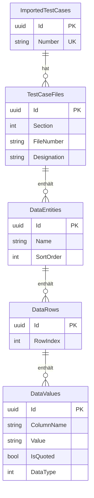

# Datei-Import / -Export (Datei-Testfälle)

Ein eigenständiges Subsystem, das dateibasierte Testfälle aus dem Ordner
`Workspace/Testfälle` in die Datenbank **einliest** und aus der Datenbank wieder
inhaltsgleich als Dateien **ausliest** (wiederherstellt). Verknüpft werden alle
Daten über die **Testfallnummer**.

## Ordner- und Dateiformat

```
Workspace/Testfälle/
  Input/  {Nummer}_TF/ {FileNr}_{Bezeichnung}.Eingabe
  Output/ {Nummer}_TF/ {FileNr}_{Bezeichnung}.Ausgabe
```

Inhalt einer Datei (eingerücktes Schlüssel-Wert-Format):

```
b_Gebaeude                    ← Entity (Tabelle)
    (0)_Gebaeude              ← Zeile mit Index 0
        tuer=2               ← Spalte=Wert (Ganzzahl)
        baujahr="01.01.1965" ← Spalte=Wert (Text, in Anführungszeichen)
        stockwerke=4
b_Personen
    (0)_Personen
        name=Rainer
    (1)_Personen             ← weitere Zeile, darf andere Spalten haben
        geschlecht=4
```

- `b_{Name}` = Entity/Tabelle · `({Index})_{Name}` = Zeile · `Spalte=Wert` = Zelle.
- Werte in Anführungszeichen werden als Text behandelt; unquotierte Werte werden
  automatisch als Ganzzahl/Dezimalzahl/Text erkannt.
- Spalten dürfen je Zeile variieren (dünn besetzt).

## Datenmodell (generisches Meta-Modell)

Damit beliebige und variable Spalten verlustfrei gespeichert werden, wird ein
generisches Meta-Modell verwendet (kein dynamisches Tabellen-DDL):



`Number` (Testfallnummer) ist der eindeutige fachliche Schlüssel; `IsQuoted` und
`DataType` sichern die exakte Rekonstruktion.

## Bedienung in der Anwendung

Navigation **„Import / Export"**:

- **Wurzelordner** wählen (Standard: automatisch erkanntes `Workspace/Testfälle`).
- **Einlesen** – liest alle Dateien in die Datenbank (Upsert je Testfallnummer,
  bestehende werden ersetzt, keine Duplikate).
- **Auslesen** – schreibt alle gespeicherten Testfälle wieder als Dateien.
  Damit lassen sich zuvor gelöschte Eingabe-/Ausgabedateien inhaltsgleich
  wiederherstellen.
- Die Tabelle zeigt je Testfallnummer die Anzahl Dateien, Entities, Zeilen und Werte.

## Unternehmensindividuelle Anpassung (Erweiterungspunkt)

Das **Format** ist austauschbar. Zwei Interfaces in
`TestCaseManager.Application.FileFormat` bilden den Anpassungspunkt:

| Interface | Aufgabe | Standard-Implementierung |
|-----------|---------|--------------------------|
| `ITestCaseFileParser` | Text → Modell (Einlesen) | `IndentedKeyValueFileParser` |
| `ITestCaseFileWriter` | Modell → Text (Auslesen) | `IndentedKeyValueFileWriter` |

Für ein abweichendes Firmenformat genügt eine eigene Implementierung, die in
`TestCaseManager.Application/DependencyInjection.cs` statt der Standardklassen
registriert wird:

```csharp
services.AddSingleton<ITestCaseFileParser, MeineFirmenParser>();
services.AddSingleton<ITestCaseFileWriter, MeineFirmenWriter>();
```

Alles Übrige (Ordner-Scan, Datenbankspeicherung, Round-Trip, Oberfläche) bleibt
unverändert. Der Ordner-Scan und die Dateiverwaltung liegen in
`TestCaseManager.Infrastructure/Services/TestCaseFileService.cs`.

## Verlässlichkeit

Automatisierte Tests sichern das Verhalten ab
(`TestCaseManager.Tests/FileFormat` und `.../Services`):
Parsen, Serialisieren, der Round-Trip *Datei → Datenbank → inhaltsgleiche Datei*
sowie das duplikatfreie erneute Einlesen.
